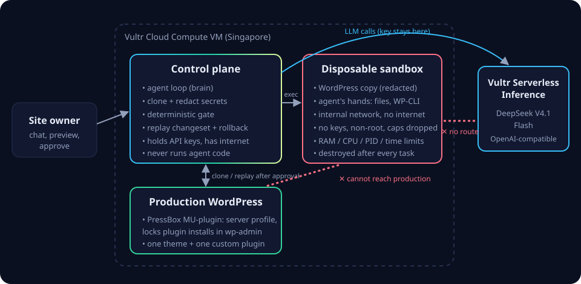

<p align="center"></p>

<h1 align="center">PressBox</h1>

<p align="center"><b>Chat with your WordPress site. An AI agent builds the change in a disposable sandbox on Vultr; a deterministic gate and you approve it before it reaches production.</b></p>

<p align="center">Vultr Agent Rush · Challenge 1: <i>Blast Radius Zero</i> · by Ngorbit Lab</p>

| | |
| --- | --- |
| **Live demo** | https://pressbox.149-28-138-40.sslip.io (landing) · https://pressbox.149-28-138-40.sslip.io/app (app) |
| **Production demo site** | https://senja.149-28-138-40.sslip.io (Senja Coffee, managed by PressBox) |
| **Judge access code** | in our lablab submission (unlocks the live agent; visitors can also bring their own Vultr Serverless Inference key) |
| **Stack** | Vultr Cloud Compute · Vultr Serverless Inference (DeepSeek V4.1 Flash) · Docker · WordPress 7.1 + WP-CLI · Node.js (no dependencies) |

---

## The problem

WordPress runs about 43% of the web (W3Techs), mostly for small businesses and the agencies that look after them. Changing a live site is still risky: a broken plugin update or a hurried code edit takes the site down, and 91% of new WordPress vulnerabilities in 2025 were in plugins (Patchstack). AI site builders generate a site once; after launch, owners are back to plugins, page builders and hoping nothing breaks.

An AI agent that edits a live WordPress site directly would make this worse: it writes and runs PHP on the server that holds customer data.

## What PressBox does

The site owner types a request: *"Add a table reservation form to the Contact page."*

1. **Clone and contain.** PressBox copies production into a fresh Docker container. User passwords, login sessions and secret-looking settings are redacted first. The container has no network route out, no API keys, no Linux capabilities, a non-root user, CPU/RAM/process limits, and the PHP time and memory limits of production.
2. **Build and self-correct.** The agent (an LLM on **Vultr Serverless Inference**) works only through tools that act inside the sandbox: it edits the site's single custom plugin and runs allow-listed WP-CLI commands. It tests pages, reads the PHP error log, and fixes its own mistakes. It follows the official [WordPress Agent Skills](https://github.com/WordPress/agent-skills).
3. **Gate.** Deterministic code, not the model, decides whether the result may ship (see [the gate](#the-gate)).
4. **Preview and approve.** The owner clicks through the sandbox site and reads the exact diff and WP-CLI commands.
5. **Replay onto production.** After a backup, the plugin is staged and PHP-linted outside the live plugin directory, swapped in with one rename, the WP-CLI commands are rerun and every page is health-checked, with automatic rollback. The sandbox database is never copied back, so orders or bookings made meanwhile are never overwritten.
6. **Destroy.** The sandbox is removed and the removal is verified.

Every feature lands in the site's own custom plugin: one theme, one plugin, no pile of third-party plugins.

## Architecture



| Component | Where | Role |
| --- | --- | --- |
| Control plane (`control/`) | Vultr VM, container | Chat UI, agent loop (the brain), clone and redaction, sandbox lifecycle, gate, replay to production. Holds the inference key and has internet. **Never executes agent-written code.** |
| Sandbox (`wp/`, role `sandbox`) | Vultr VM, one container per task | The agent's hands. WordPress + WP-CLI copy of production on an `internal` Docker network. |
| Production WordPress (`wp/`, role `live`) | Vultr VM, container | The managed site. Ships the **PressBox MU-plugin**. |
| PressBox MU-plugin (`wp/pb/pressbox-agent.php`) | Inside every managed site | `wp pressbox profile` reports the web server's real PHP profile (via an authenticated loopback, because CLI limits differ). Disables plugin/theme installs and file edits in wp-admin so every change goes through PressBox. |
| LLM | Vultr Serverless Inference | OpenAI-compatible chat completions with tool calling (`deepseek-v4.1-flash-1017`). |

### How Vultr is used

| Vultr service | Use |
| --- | --- |
| **Cloud Compute** (vc2-1c-2gb, Singapore) | Runs the control plane, every sandbox and the production site. Provisioned through the **Vultr API** with [`scripts/provision-vultr.mjs`](scripts/provision-vultr.mjs) and [`scripts/cloud-init.sh`](scripts/cloud-init.sh). |
| **Serverless Inference** | Every agent LLM call: `POST https://api.vultrinference.com/v1/chat/completions` with tools. The key lives only in the control plane process. |

No other model provider is called at runtime.

## Containment: the four rules

| Rule | Implementation | Code |
| --- | --- | --- |
| **1. Process isolation** | One container per task, created by the control plane via the Docker API. `--cap-drop ALL`, `--security-opt no-new-privileges`, `--user 82:82` (www-data), only on the `pb_sandbox` network (`internal: true`: no gateway, so no internet, no `169.254.169.254` metadata endpoint, no route to production). No published ports. The control plane joins that network only to reach sandboxes; both of its servers drop any connection that comes *from* the sandbox subnet. Previews go through a proxy on a separate origin that strips cookies and `Authorization` in both directions, so sandbox JavaScript cannot touch the control UI or production's wp-admin session. Agent commands run through `docker exec` with argv arrays, never a shell string. | [`sandbox.js`](control/src/sandbox.js), [`server.js`](control/src/server.js), [`net.js`](control/src/net.js), [`docker-compose.yml`](docker-compose.yml) |
| **2. No credentials in the sandbox** | No environment variables besides the preview URL and PHP limits. Generic `wp-config.php` with per-container salts. Before the copy enters the sandbox: user passwords replaced by invalid hashes, session tokens deleted, options named like `*password*`, `*secret*`, `*token*`, `*api_key*` masked with a marker the gate watches for in outbound traffic. | [`sandbox.js` `redactDatabase`](control/src/sandbox.js), [`wp-config.php`](wp/wp-config.php) |
| **3. Time, memory and disk limits** | Container: 512 MB RAM (no swap), 1 CPU, 200 PIDs, read-only root filesystem; the only writable places are a 256 MB tmpfs for `wp-content` and a 64 MB tmpfs for `/tmp`, both charged to the RAM limit, so nothing reaches the host disk. Web PHP runs with `disable_functions` for process spawning and `allow_url_fopen=0`. Per request: PHP memory and `max_execution_time` copied from production's profile. Per command: `timeout -s KILL 30`. Agent: 24 steps, 8-minute task limit, step-budget warning. Review window: 15 minutes, then the sandbox is destroyed. | [`config.js`](control/src/config.js), [`entry.sh`](wp/pb/entry.sh) |
| **4. Destroyed after every task** | Applied, discarded, blocked, failed or expired: every path calls `docker rm -f` and verifies the container is gone; the log shows how long it lived. Orphans are removed when the control plane starts. | [`tasks.js`](control/src/tasks.js), [`sandbox.js` `destroySandbox`](control/src/sandbox.js) |

Verified on the live VM with `docker inspect` and from inside a sandbox: `CapDrop=[ALL]`, `no-new-privileges`, `Memory=512MiB`, `Pids=200`, no port bindings, network `pb_sandbox` only, no API key in the environment; `curl` to the internet, to `169.254.169.254` and to the production container all fail.

### What the agent can and cannot do

| Can | Cannot |
| --- | --- |
| Read/write files inside the custom plugin (`.php .css .js .json .html .svg`) | Touch any path outside it (`..`, absolute paths, other extensions are refused) |
| `wp post/option/menu/term/widget/rewrite/cache/transient …` | `wp eval`, `db`, `config`, `core`, `plugin install`, `user create`, `--exec`, `--require`, `--user`, short flags, file arguments (`post update 7 <file>`), filesystem paths, `option patch`/`delete` or any write to protected options such as `siteurl`, `default_role`, `wp_user_roles`, `active_plugins` or anything secret-looking, `post meta patch` and internal meta keys (names are checked on positionals, so an early flag cannot hide them) |
| Request pages of its sandbox and read new PHP log lines | Reach production, the internet, cloud metadata, or the control plane |
| Read 17 official WordPress Agent Skills guides | Approve its own work, or apply anything: only the browser session that started a task can see, apply or discard it |

## The gate

Runs after the agent finishes and judges the **final** state (errors the agent already fixed do not count). Sandboxes run without OPcache, so the agent's tests and the gate always execute the file as it is on disk, never stale bytecode from a version written a second earlier. All checks must pass before *Apply to production* appears.

- The agent called `finish`, and there is a change to review.
- `php -l` passes for every plugin file.
- Static scan: no `eval`/`assert`, system commands, backticks, raw sockets or `curl_*`, URL reads outside the WordPress HTTP API (`file_get_contents('https://…')`, `fopen`, `readfile`), user/role changes, obfuscation (`base64_decode`, `gzinflate`, `str_rot13`), raw `$wpdb->query`, writes to core files.
- No hard-coded outbound hosts outside the owner-approved list, and no outbound call whose URL is computed at runtime.
- No PHP extension production lacks (from the MU-plugin profile).
- Every published page renders with HTTP 200, no critical-error page, within the time limit.
- No fatal errors while the gate re-renders the site.
- No outbound connection attempts through the WordPress HTTP API (recorded by a sandbox-only observer MU-plugin), and no redacted secret in any of them. Other ways out are caught by the static scan above; the network blocks all of them either way.
- The gate requests pages with an ordinary browser user agent and the sandbox does not expose its role to PHP, so plugin code has fewer cues to behave differently under test.
- Administrator accounts unchanged; container not OOM-killed.

### How it was reviewed

Besides the unit and end-to-end tests, the containment layer went through two adversarial reviews: a code audit and a four-surface review (agent tools, control API, sandbox escape, gate and replay) in which every finding had to survive an independent skeptic. Confirmed findings were fixed and covered by tests: sandbox-to-control-plane access, unauthenticated apply, WP-CLI file arguments and protected-option bypasses (including `option patch`), cookie forwarding through the preview proxy, host-disk writes from sandboxes, and apply without staging.

## Measured results

From end-to-end runs on the Vultr VM and locally, with `deepseek-v4.1-flash-1017`:

| Scenario | Result | Time | Tokens (in / out) |
| --- | --- | --- | --- |
| Reservation form on the Contact page | Passed the gate, applied, form saves bookings on production | 34–47 s | 40k–175k / 9k–19k |
| Exchange rate from an external API | Blocked: the agent wrote the widget, the gate rejected the unapproved domain, the sandbox was destroyed | 23 s | 35k / 4k |
| Promo banner with a never-ending loop (scripted) | Blocked by the 20 s per-request limit copied from production | 76 s | – |
| Change the tagline (scripted) | Passed, applied | 9 s | – |

At Vultr's list price for DeepSeek V4 Flash ($0.30 in / $1.00 out per million tokens) a reservation-form task costs about $0.02–0.07, depending on how many self-corrections the agent needs.

## Run it

```bash
cp .env.example .env     # LLM_API_KEY = Vultr Serverless Inference key; set JUDGE_ACCESS_CODE
docker compose up -d --build
```

- Landing page: http://localhost:8300 · app: http://localhost:8300/app
- Production demo site: http://localhost:8080 (wp-admin user `owner`, password from `LIVE_ADMIN_PASSWORD`)
- Reset the demo site: `sh scripts/reset-live.sh`

Without `LLM_API_KEY` the app runs in **scripted mode**: a stand-in for the LLM replays fixed scenarios so the pipeline can be tested without tokens. The UI shows a banner whenever this is active.

### Deploy on Vultr

```bash
VULTR_API_KEY=... node scripts/provision-vultr.mjs --ssh-key ~/.ssh/pressbox_vultr.pub
scp .env root@<ip>:/opt/pressbox/.env          # with PUBLIC_URL etc. set to http://<ip>:port
ssh root@<ip> 'cd /opt/pressbox && docker compose up -d'
```

For HTTPS on separate hosts, set `COMPOSE_PROFILES=https`, `APP_HOST`, `PREVIEW_HOST`, `LIVE_HOST` and the matching `https://` values of `PUBLIC_URL`, `PREVIEW_PUBLIC_URL`, `LIVE_PUBLIC_URL` in `.env`. Caddy ([`scripts/Caddyfile`](scripts/Caddyfile)) then gets the certificates. The public demo uses `pressbox.`, `preview.` and `senja.149-28-138-40.sslip.io`. The preview keeps its own host so sandbox JavaScript never shares an origin with the app.

The Vultr account key is only used by the provisioning script; `docker-compose.yml` blanks it for the control plane.

## Tests

```bash
cd control && npm test                                   # unit tests: path, WP-CLI, static-scan and access policies
docker compose -f docker-compose.yml -f scripts/compose.scripted.yml up -d
node scripts/smoke.mjs all --apply                       # end-to-end, scripted mode, no tokens
PB_JUDGE_CODE=... node scripts/smoke.mjs reservation     # end-to-end with the real LLM
```

## Repository layout

```
control/                control plane (Node.js 22, no npm dependencies)
  src/agent.js          agent loop and system prompt
  src/tools.js          the agent's tools and their policies
  src/sandbox.js        clone, redact, create, exec, destroy
  src/gate.js           deterministic checks
  src/production.js     server profile, health check, replay with backup and rollback
  src/access.js         judge code and own-key sessions
  src/server.js         HTTP API, event stream, preview proxy
  public/               landing page, app, brand
  knowledge/            official WordPress Agent Skills (GPL), read by the agent at runtime
  test/                 unit tests
wp/                     WordPress image used for production and sandboxes
  theme/senja/          demo site theme, built on the TailPress boilerplate (Tailwind, MIT)
  pb/pressbox-agent.php PressBox MU-plugin
  pb/pb-observer.php    sandbox-only observer of outbound HTTP and fatals
scripts/                provisioning, smoke tests, demo reset
```

## Limitations

- The demo uses SQLite so a site is one file to clone; MySQL needs a dump/restore step in the clone path.
- Replay assumes production did not change the same content while a task was running; there is no conflict detection yet.
- One task at a time per deployment.
- Isolation is Docker with dropped capabilities and an internal network; gVisor or microVMs (Vultr VX1 supports nested virtualization) would add a kernel boundary.
- Rollback restores the database snapshot taken just before the apply, so anything written to production during those few seconds is lost; a row-level replay would avoid that.
- A determined plugin can still guess it is in a sandbox (no network, preview URL). The gate is one layer; the owner's review of the diff and the containment itself are the others.
- The demo serves plain HTTP on an IP address.

## Roadmap

- "Deploy a new site" from the app: a Vultr VM per customer site through the Vultr API, managed remotely by the control plane.
- gVisor runtime, then Microsandbox microVMs on Vultr VX1.
- Connect existing WordPress sites through the MU-plugin (clone and replay over an authenticated channel).
- Parallel branches ("give me three versions of the header"), visual diffs with Playwright, MySQL support.

## Business model

Managed WordPress with a built-in agent, sold per site: hosting on Vultr plus chat-driven changes for small businesses, and a fleet plan for agencies that maintain dozens of client sites.

Proposed pricing (a hypothesis to validate with customers, not a measured result):

| Plan | Price | What it includes | Our cost at Vultr list prices | Gross margin |
| --- | --- | --- | --- | --- |
| Site | $19 / month | 1 site on its own Vultr vc2-1c-1gb VM, 30 agent changes | $5 VM + 30 × ~$0.05 inference ≈ $6.50 | ~66% |
| Agency | $149 / month | 10 sites, 300 changes, shared review queue | 10 × $5 + 300 × ~$0.05 ≈ $65 | ~56% |

The VM price is Vultr's published $5/month for vc2-1c-1gb; the per-change cost is our measured reservation-form run at the DeepSeek V4 Flash list price.

## License

MIT (see [`LICENSE`](LICENSE)). `control/knowledge/wp-agent-skills/` contains unmodified files from [WordPress/agent-skills](https://github.com/WordPress/agent-skills) under the GPL (see the `NOTICE.md` there).
